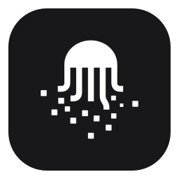
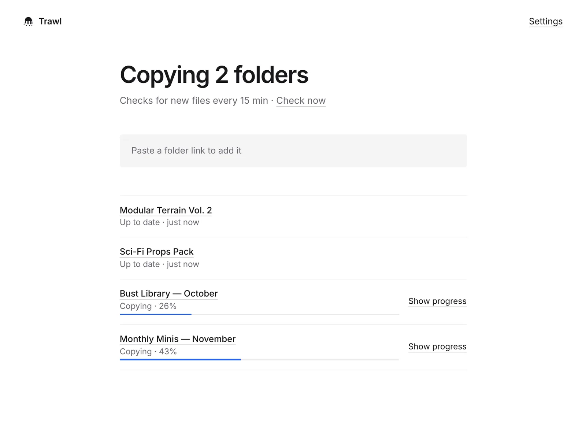
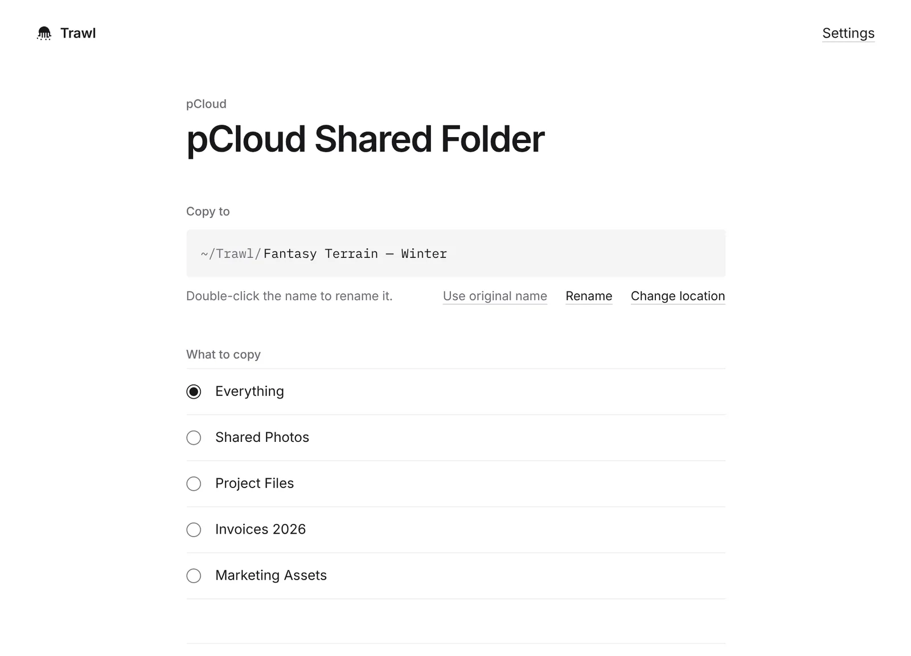
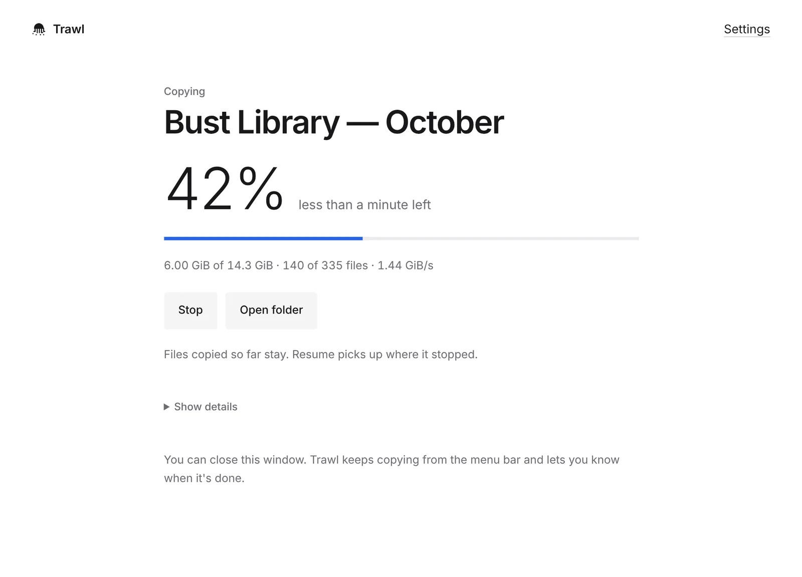
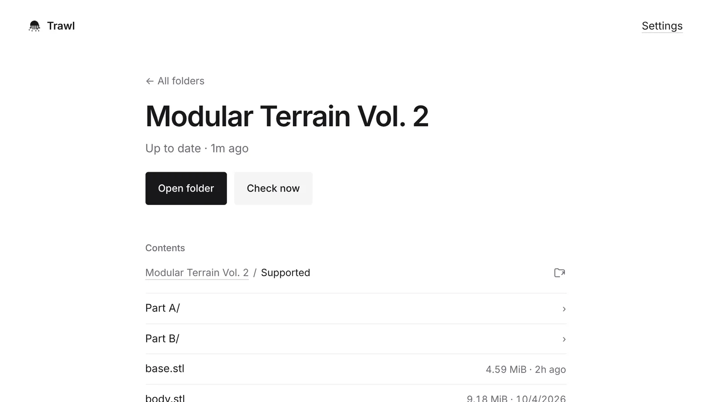

<div align="center">



# Trawl

### Keep a local copy of any shared cloud folder.

A small desktop app that copies Google Drive and pCloud folders to your computer from a share link, using [`rclone`](https://rclone.org). Paste the link, pick where it goes, and Trawl keeps it up to date. It only adds files and never deletes anything on your side.

[](https://github.com/kurenn/trawl/releases/latest)
[](https://github.com/kurenn/trawl/actions/workflows/release.yml)
[](LICENSE)


[](https://buymeacoffee.com/kurito)

[**Download**](https://github.com/kurenn/trawl/releases/latest) &nbsp;·&nbsp; [**Quick start**](#quick-start) &nbsp;·&nbsp; [**Website**](https://kurenn.github.io/trawl/)

<br/>



</div>

---

## Why Trawl?

Someone shares a Google Drive or pCloud folder with you (models, assets, a dump of photos) and you want a copy on your machine that keeps up when they add things. `rsync` can't talk to Drive. The web UI won't download a big folder in one go. A two-way sync client can overwrite or delete your local files.

Trawl does one thing. You give it a shared folder and a local destination, and it downloads new and changed files when you ask or on a schedule. Files at the destination are never deleted.

## Features

- **Add a folder by link.** Paste a Google Drive folder URL or ID, or a pCloud public link. Trawl shows what's inside before it copies anything, and you can take the whole folder or one subfolder.
- **One library folder.** New folders go under your library (`~/Trawl` by default, created for you). Each one gets a page in the app where you can browse and open its files.
- **Live progress.** The Rust backend reads rclone's stats and shows the percentage, size, file count, speed and time left for each copy.
- **Automatic checks.** Trawl checks every folder for changes every 15 minutes, or every hour, six hours or day, or only when you ask. `rclone copy` only transfers what changed, so a check with nothing new is cheap. You can turn checks off for a single folder.
- **Keep my edits.** On by default. A file you edited locally is never replaced by an older copy from the source. If the source has a newer version, your copy is moved to a `.trawl-replaced` folder next to the destination instead of being lost.
- **Plain error messages.** A failed copy shows what happened in one sentence and a button to fix it or retry. If a Google Drive shortcut loops back into its own parent, Trawl stops early and offers to skip shortcuts.
- **Survives flaky destinations.** If a network share stops responding or a disk is unplugged mid-copy, Trawl stops and reports it. It won't start re-downloading the whole library into an empty mount point.
- **Nothing else to install.** rclone is bundled with the app as a Tauri sidecar. Install with Homebrew, a one-line script, or a regular download.

> **Local and private.** rclone saves your Google sign-in token on your machine (`~/.config/rclone/rclone.conf`). Trawl has no account, no server and no telemetry.

## See it in action

**Paste a folder link.** Trawl shows what's inside. Take everything or one subfolder, and rename the local folder if you want.

<div align="center"></div>

**Let it copy.** Watch the progress, or close the window and Trawl finishes from the menu bar.

<div align="center"></div>

**Open what arrived.** Each folder has its own page where you can browse and open its files.

<div align="center"></div>

## Quick start

rclone comes with the app, so you don't need to install it separately.

**macOS, with Homebrew (recommended):**

```bash
brew install --cask kurenn/tap/trawl
```

**macOS or Linux, with the install script:**

```bash
curl -fsSL https://raw.githubusercontent.com/kurenn/trawl/main/scripts/install.sh | bash
```

**Or download it yourself** from the [Releases](https://github.com/kurenn/trawl/releases/latest) page:

- **macOS:** open the `.dmg` and drag Trawl to Applications. Builds are signed and notarized by Apple, so it opens like any other app. Use `aarch64.dmg` for Apple Silicon and `x64.dmg` for Intel.
- **Windows:** run the `.msi` or `-setup.exe`. If SmartScreen stops it, click More info, then Run anyway.
- **Linux:** use the `.AppImage` (`chmod +x` it and run it), the `.deb`, or the `.rpm`.

The first time you paste a Google Drive link, Trawl asks you to sign in with Google. That runs rclone's OAuth flow in your browser and saves the token once. pCloud public links don't need a sign-in.

## Build from source

You need Node 20+ and the Rust toolchain (see the [Tauri v2 prerequisites](https://v2.tauri.app/start/prerequisites/)).

```bash
git clone https://github.com/kurenn/trawl.git
cd trawl
npm install

npm run dev            # web UI on a simulated backend (http://localhost:1420)

# The desktop app bundles rclone as a sidecar. Fetch it for your platform once
# (the build fails without it). You don't need rclone installed on the system.
./scripts/fetch-rclone.sh
npm run tauri dev      # full desktop app
npm run tauri build    # → src-tauri/target/release/bundle/ (.dmg, .msi, .AppImage…)
```

`npm run dev` runs the whole UI against a built-in simulation (a fake Drive/pCloud catalog with animated copies), so you can click through everything in a normal browser without rclone or a cloud account.

Tests, all from the repo root:

```bash
npm run check                           # frontend logic (link parsing, folder-name cleaning, status text)
cargo test --workspace --exclude trawl  # trawl-core and trawl-cli; no built frontend needed
cargo test -p trawl --lib               # the Tauri app's own tests
```

## Headless / Omarchy

For servers and tiling window managers there's a CLI with no window or tray icon. It only needs `rclone`. The systemd parts below are Linux only.

```bash
cargo install --path crates/trawl-cli
```

`trawl-cli` uses the desktop app's data (`~/.local/share/com.trawl.app` on Linux) and the same run locks. The app and the CLI never copy the same folder at the same time, and writes to `mappings.json` are serialized across processes. Add folders and sign in to Google Drive from the app first. pCloud links need no sign-in.

```
trawl-cli status [--json]   # JSON snapshot of every mapping (schema below); prints JSON with or without the flag
trawl-cli sync <id>         # run one mapping now and wait; live progress goes to the progress file (read it with `status`)
trawl-cli start <id>        # start one mapping in the background
trawl-cli cancel <id>       # stop a run started by systemd or the CLI (not one the desktop app started)
trawl-cli sync-due          # start every due mapping as a systemd unit (needs `install-units`); respects the app's check setting (including "Only when I ask") and each mapping's own toggle
trawl-cli install-units     # write and enable the systemd user units (below)
trawl-cli uninstall-units   # remove them
```

Exit codes: `0` ok or cancelled, `1` failure, `2` usage error.

`status` prints:

```jsonc
{
  "schema": 1,
  "mappings": [
    {
      "id": "...", "name": "...", "provider": "gdrive", // or "pcloud"
      "src": "...",          // the rclone source label
      "dest": "...",         // display only
      "auto_sync": true, "enabled": true,
      "last_status": "...",  // one of the mapping statuses
      "last_at": "2024-01-01T00:00:00Z", // RFC3339, or null
      "last_files": 12, "last_bytes": 345678, "last_error": null,
      "running": false,     // a run lock is held, by the app or the CLI
      "progress": null      // live progress for CLI-driven runs; null for app-driven runs (which show running:true, progress:null)
    }
  ]
}
```

`status` never reads destination paths.

**systemd (Linux):** `trawl-cli install-units` writes `trawl-sync@.service`, `trawl-auto.service` and `trawl-auto.timer` to `~/.config/systemd/user/`. The units point at the installed `trawl-cli` binary and record your current `PATH` so `rclone` resolves the same way. The command then enables the timer, which fires every 5 minutes starting 2 minutes after boot and starts at most 3 copies at once. `trawl-cli uninstall-units` removes them.

> Setting "Check for new files" to "Only when I ask" in the app also stops the systemd timer from starting copies, because both read the same `auto_sync_enabled` setting. Running the app and the timer together is safe: the run lock stops a folder from copying twice at once.

The CLI looks for `rclone` next to the `trawl-cli` binary first, then on `PATH`. Google Drive folders need the `gdrive` remote that the app's sign-in creates. pCloud links need nothing.

## Architecture

The Rust side owns rclone. It creates the Drive remote, lists source folders, runs `rclone copy` with `--use-json-log --stats`, and sends parsed progress to the UI as events. The React side owns the UI and talks to one typed API. At runtime an adapter picks either the real Tauri backend or the browser simulation, and the views don't know which one they're using.

```
src/                        React + TS frontend
  types.ts                  shared contract (domain types, Api, useTrawl hook)
  store.tsx                 app state (TrawlProvider + useTrawl)
  format.ts                 link parsing, folder-name cleaning, status text
  api.ts                    picks the real (Tauri) or sim (browser) adapter
  tauri/tauriApi.ts         real adapter: invoke() + run events
  sim/                      browser simulation adapter + fake catalog
  views/                    Home · Preview · Folder · Contents · Copying · Settings
  theme.css                 design tokens (CSS variables)

src-tauri/src/              desktop app (Tauri)
  commands.rs               #[tauri::command] glue, AppState, run lifecycle
  scheduler.rs              in-process auto-check ticker
  tray.rs                   menu bar / tray icon

crates/trawl-core/src/      logic shared by the app and the CLI
  rclone.rs                 connect/list/copy/cancel + error mapping
  pcloud.rs                 pCloud public-link listing + download
  store.rs                  mappings.json + destination path checks
  locks.rs                  cross-process run locks
  schedule.rs               when a mapping is due
  models.rs                 serde mirror of types.ts

crates/trawl-cli/src/       headless CLI + systemd units
```

**Stack:** Tauri v2, Rust (`tokio`, `serde`), rclone, React 19, TypeScript and Vite.

### Security note

Destinations are checked in two places. The frontend builds each new folder's destination from the library root plus a cleaned folder name (`format.ts::cleanFolderName`), which strips path separators, control characters and `.`/`..`. The backend stores that as an absolute path and only checks that it is absolute (`store.rs::effective_dest`), so the frontend cleaner is the guard for new folders and is covered by `npm run check`. Folders created before per-folder destinations existed use a relative subpath instead. `store.rs::resolve_dest` checks that path: it rejects `..`, absolute paths and control characters, and canonicalizes the deepest existing ancestor so a symlink can't lead outside the library root.

The backend also restricts Drive folder IDs to the Drive character set, rejects a second run of a folder that is already copying, and assigns run IDs itself.

## How releases ship

Bump the version, add a changelog entry, tag and push. CI builds every platform and attaches the bundles to a draft GitHub Release.

```bash
# 1. bump the version in package.json, src-tauri/tauri.conf.json, src-tauri/Cargo.toml,
#    crates/trawl-core/Cargo.toml and crates/trawl-cli/Cargo.toml
# 2. add a "## [x.y.z]" section to CHANGELOG.md (it becomes the release notes)
# 3. tag and push:
git tag v0.4.2 && git push origin v0.4.2
```

## Out of scope

Run history and a "remote path" source mode. Trawl only downloads. It doesn't upload, do two-way sync or delete anything at the destination.

## Contributing

Issues and PRs are welcome. To run it locally, `npm install` then `npm run tauri dev`. The UI also runs on its own with `npm run dev`.

## Support

Trawl is free and open source, with no account, server or telemetry. If it's useful to you, you can [buy me a coffee](https://buymeacoffee.com/kurito). Thanks!

## License

[MIT](LICENSE) © Spoolr.
